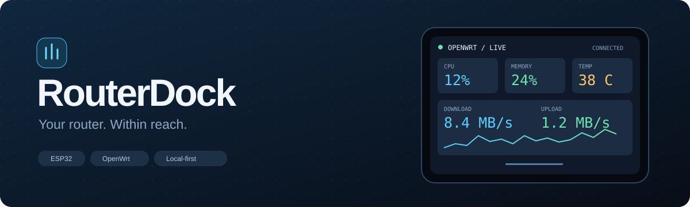
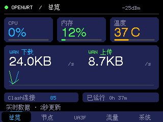
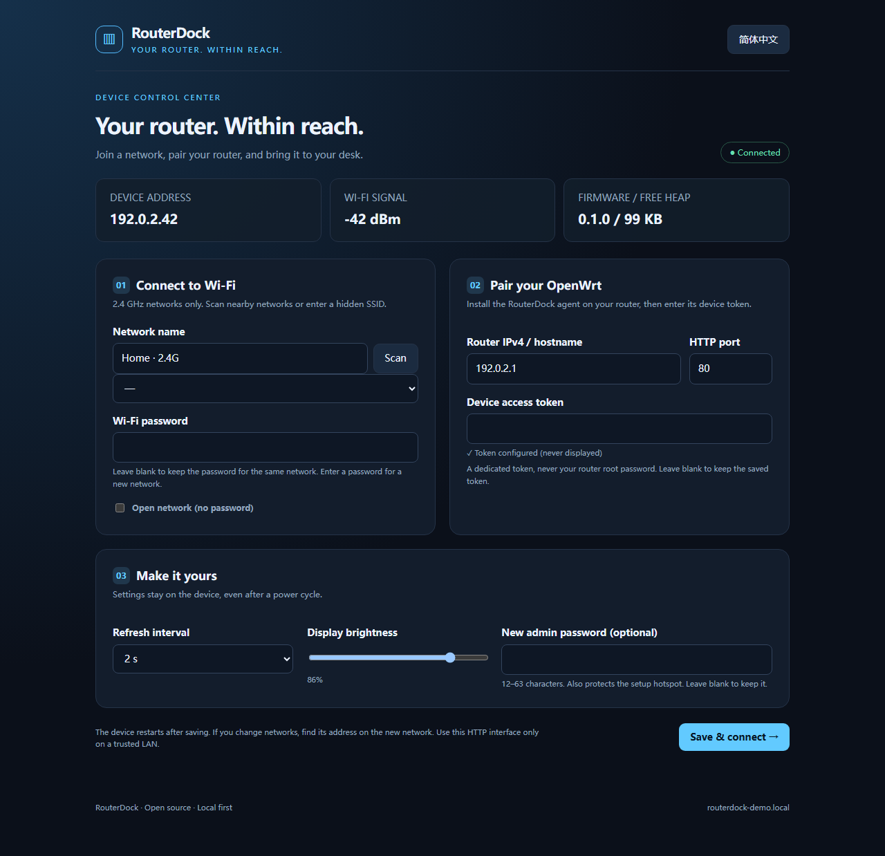
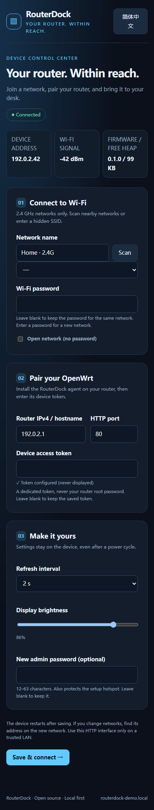

<div align="center">



**A touch-first OpenWrt companion for your desk.**

[](https://github.com/cndoin/routerdock/actions)
[](https://github.com/cndoin/routerdock/releases)
[](LICENSE)


**English** · [简体中文](README.zh-CN.md)

[Get started](docs/INSTALL.md) · [Hardware](docs/HARDWARE.md) · [Compatibility](docs/COMPATIBILITY.md) · [Contribute](CONTRIBUTING.md)

</div>

<p align="center"></p>

Keep your router's pulse beside your keyboard. RouterDock turns an ESP32 touchscreen into a small, local control surface: system health, live traffic, proxy selection and UA3F activity, without opening LuCI for every glance.

**No cloud account. No hardcoded Wi-Fi credentials. No router root password on the display.**

The screen capture above comes from a physical ESP32 and a real OpenWrt router. The banner is an illustration. Web settings screenshots below use the real portal code with demonstration network details, not personal credentials.

## A small screen, a useful view

| View | What it does |
| --- | --- |
| **Overview** | CPU, memory, temperature, real WAN RX/TX, a two-line trend, Clash connections and uptime. Tap connections for details. |
| **Nodes** | Browse policy groups, switch Selector members, test a page or one node, and see latency or timeout. |
| **UA3F** | Service state, retained connection/pass/rewrite records, rewrite ratio and recent targets. |
| **Traffic** | Live rates, a short history and cumulative counters, with the accounting source explicitly shown. |
| **System** | Router/device details, process information, service actions, touch calibration and device settings. |

Network requests run separately from the touch/render loop. Missing optional plugins do not disable system monitoring; failed reads keep the previous values and show stale state.

## Configure it from your browser



Scan nearby **2.4 GHz** networks, enter a router address and device token, choose a refresh interval and brightness, and change the admin password. Settings persist in ESP32 NVS across reboots.

- **First boot:** the display shows a unique `RouterDock-xxxxxx` hotspot and password. Join it, open `http://192.168.4.1`, and sign in as `admin` using that password.
- **Already connected:** use the device's LAN IP, or `http://routerdock-xxxxxx.local` where mDNS is available. Find the address under **System → Device settings**.
- **Recovery:** hold **BOOT for four seconds** to reopen setup. A failed Wi-Fi connection also opens setup after 45 seconds. No factory reset is needed.
- Wi-Fi passwords and router tokens are never returned by the settings API. Blank secret fields retain existing values. Admin login and CSRF protection guard writes.

<details>
<summary>Mobile settings</summary>



</details>

## Get started

### 1. Install the router agent

Download the [latest release](https://github.com/cndoin/routerdock/releases/latest), upload `routerdock-agent.tar.gz` to the router, then run as root:

```sh
mkdir -p /tmp/routerdock
tar -xzf /tmp/routerdock-agent.tar.gz -C /tmp/routerdock
sh /tmp/routerdock/install.sh
```

The installer checks dependencies, installs one authenticated CGI endpoint and prints a dedicated device token. It does **not** restart the router, modify OpenClash/UA3F settings, or add firewall rules. Keep the token for step 3. See [installation](docs/INSTALL.md) for dependencies and source installs.

### 2. Flash the display

Use the release's flash bundle or build from source:

```sh
git clone https://github.com/cndoin/routerdock.git
cd routerdock
python scripts/embed_portal.py
pio run -d firmware
pio run -d firmware -t upload --upload-port YOUR_SERIAL_PORT
```

The default target is the **ESP32-32E / E32R28T-style 2.8-inch ILI9341 + XPT2046 board** documented in [Hardware](docs/HARDWARE.md). Similar-looking CYD boards may have different pinouts. Router CPU architecture and display board compatibility are separate questions.

### 3. Pair it

Join the display's setup hotspot, select your Wi-Fi, and enter the router's LAN address, HTTP port and device token. Save and reconnect. Wi-Fi can be configured first; add the router token later from the LAN settings page.

For a second router, install its own agent and replace the address/token in device settings. No source edits or recompilation are needed.

## Designed for OpenWrt, honest about compatibility

The agent uses Lua, `/proc`, `/sys`, `ubus`, `uci` and `curl`: its source is CPU-independent. **Physical-router verification currently covers one x86 iStoreOS 24.10.5 system**, OpenClash 0.48.002 with Mihomo, and UA3F 3.7.0. ARM/MIPS builds and custom firmware still need community testing; they are not presented as hardware-verified.

OpenClash/Mihomo and UA3F are optional. Different logical WAN/LAN names or controller endpoints can be configured in `/etc/config/routerdock`. See [compatibility and test scope](docs/COMPATIBILITY.md).

### Know what the numbers mean

- Overview traffic is **one WAN device's kernel counters**. The Traffic tab uses **Clash API totals**, falling back to WAN counters, and labels its source. These are different accounting layers and can differ.
- Node testing measures an HTTP request to a fixed test URL in **milliseconds**, not download bandwidth. It does not change the selected node.
- UA3F counters count **currently retained log records**. Rotation can lower them; they are not lifetime totals or DNS-blocking statistics.
- History is collected on demand, lives in `/tmp`, and resets after router restart or counter/source changes. There is no monthly billing database.
- Process CPU values are lifetime averages. Temperature is unavailable on devices without supported sensors.

## Local by design

Use both HTTP interfaces on a trusted LAN. Device admin passwords, Wi-Fi credentials and device tokens are stored locally; NVS and router token files are not encrypted by this project. HTTP has no transport encryption. Do not expose either interface to the internet. The setup hotspot uses a per-device password and closes after ten minutes when the device is connected; hold BOOT to reopen it.

The agent holds the Clash controller secret on the router. The ESP32 receives a narrower device token, but that token can invoke the documented service/node actions: treat it as a credential. This is a local companion, not a replacement for LuCI authentication or network isolation.

## Build, verify, contribute

```sh
python scripts/embed_portal.py
python scripts/check_public.py
npm ci
npx playwright install chromium
npm test
pio run -d firmware
```

CI checks Lua/shell syntax, collector fixtures, frontend interactions and firmware compilation. See [architecture](docs/ARCHITECTURE.md), [API](docs/API.md), [test scope](docs/COMPATIBILITY.md) and [contributing](CONTRIBUTING.md). Device settings are embedded in firmware; no separate filesystem upload or CDN is needed.

## License and acknowledgments

[MIT](LICENSE). [LovyanGFX](https://github.com/lovyan03/LovyanGFX) and [ArduinoJson](https://github.com/bblanchon/ArduinoJson) remain under their upstream licenses and are downloaded as build dependencies. Firmware builds link Espressif's Arduino core. No third-party source trees or personal firmware images are vendored here.

Visual references: [CYD-Dashboard](https://github.com/ange007/CYD-Dashboard) and [Nebula Monitor](https://github.com/Tech-Tweakers/nebula-monitor). The interface implementation and vector artwork in this repository are original; no images or code were copied from those projects.
