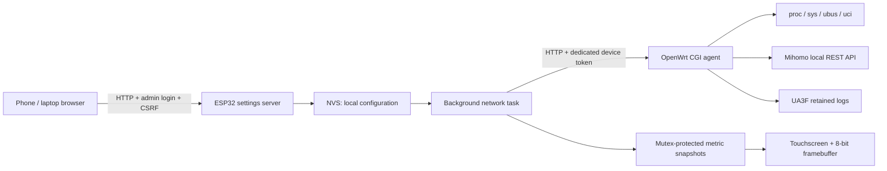

# Architecture

## Firmware

`src/main.cpp` owns the display and touch loop, FreeRTOS request task, cached page documents and node-test queue. All SPI drawing remains in the main loop. A shared metric mutex guards published documents and UI command state.

`src/DeviceConfig.cpp` owns runtime settings, password-protected WebServer routes, async Wi-Fi scan, recovery hotspot/DNS and mDNS. A separate mutex protects configuration copies read by the network task. Validated configuration is serialized into one NVS string record, preventing mixed old/new keys. No compiled credential header is used.

`web/index.html` contains the complete bilingual settings UI. `scripts/embed_portal.py` regenerates the checked-in `include/PortalPage.h`, which is stored in program flash. There is no CDN, cloud dependency, filesystem upload or firmware-upload endpoint.

The HTTP settings server is serviced from the main loop; requests are small and serialized. Asynchronous Wi-Fi scanning avoids waiting for a scan in a touch handler. It is intended for occasional local configuration, not concurrent high-load hosting.

## Router agent

`openwrt/monitor.lua` checks the device token before collecting data or executing allowlisted actions. It routes small page-specific responses, paginates nodes, percent-encodes proxy names, and uses HTTP status codes to judge controller actions.

`openwrt/collectors.lua` handles architecture-neutral Linux interfaces, CPU snapshots, MemAvailable, disk use, thermal sensors, logical-network resolution and UA3F records. Missing sensors/interfaces return unavailable fields. Process CPU is a lifetime average, not an interval measurement.

There is no persistent daemon. Reads collect on demand; caches in `/tmp` retain WAN deltas, a bounded traffic series and short-lived node-test results. Cache writes use process-specific temporary files and rename. Concurrent clients can replace a previous short-lived history snapshot; this is a single-display companion, not an accounting service.

The router root password is used only by the user to install the agent. Device tokens authorize metrics and the allowlisted node/service actions. Mihomo secrets stay router-side. Restart/update requests enqueue an installed service command, then report **submitted**, not **completed**; `/tmp/routerdock-action.log` contains execution output.
